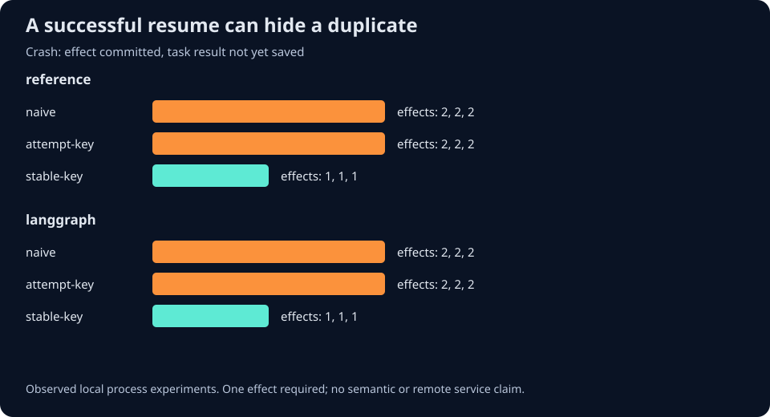
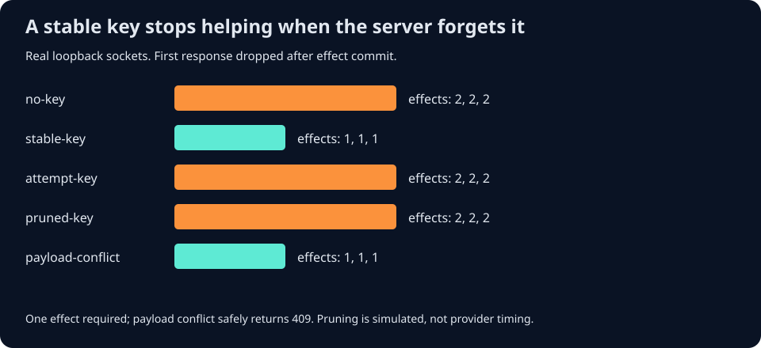
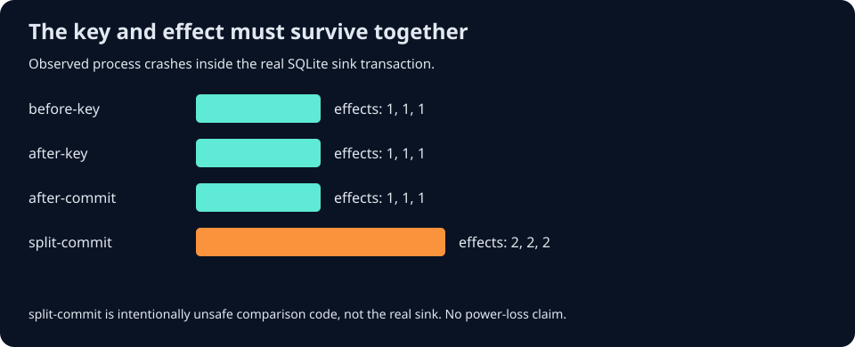

# ResumeProbe

ResumeProbe crashes durable AI workflow workers around tool effects, resumes them in new
processes, and checks the result against a separate effect ledger. It helps AI application
engineers see when a successful resume silently repeats a write.





The first verified matrix ran 90 experiments: 78 safe cases, 12 duplicate-effect cases,
zero inconclusive cases, and 90/90 expected outcomes. Every duplicate-effect case still
completed successfully. The stable-key tool committed one effect in every tested cell.

## Why use it

LangGraph task persistence, Temporal Activities, and Restate durable operations can replay
recorded results. A tool can still commit its effect before the orchestrator records the
result. ResumeProbe makes that boundary visible with actual worker process death, durable
event traces, and an independent effect-count and result-identity check.

This is a test harness for synthetic local tools. It does not invoke production services.

## Run

Python 3.11 or newer:

```bash
python -m pip install -e ".[langgraph,dev]"
resumeprobe run --adapters reference langgraph --seed 20261009 --repetitions 3 --output artifacts/run-1
resumeprobe audit artifacts/run-1/report.json
```

The output directory must not exist. Each run preserves SQLite checkpoints and effect
ledgers under its case directories, plus portable JSON, offline HTML, and an SVG comparison.
The default reference adapter uses only the Python standard library. The optional real
LangGraph adapter is pinned to LangGraph 1.2.14 and SQLite saver 3.1.1.

`run` returns 0 when every expected experimental outcome matches, including deliberately
unsafe baselines; 1 when expectations fail; 2 for invalid inputs. `audit` returns 1 if any
case is unsafe or inconclusive. A completed baseline can therefore produce exit 0 from
`run` while its effect contract fails. The report makes that distinction explicit.

## Experiment contract

Each logical operation must commit one effect with the original payload digest and return
that effect's identity. Five scenarios test no crash, before effect, after effect, after
durable task result, and after final checkpoint before response acknowledgement. Three
tool modes use no idempotency, a key stable across resumes, or a new key for each attempt.

The stable-key sink commits the key, payload digest, effect, and result in the same SQLite
transaction. Conflicting reuse fails. A regenerated key demonstrates why simply having
an idempotency-key parameter does not make recovery safe.

## HTTP response-loss experiment

Version 0.2 adds a separate loopback tool-server process. It commits the first request,
closes the socket before sending a response, and lets a fresh client process retry.
No externally supplied URL or production endpoint is accepted.

```bash
resumeprobe http-run --seed 20261009 --repetitions 3 --output artifacts/http-1
resumeprobe http-audit artifacts/http-1/report.json
```

| Retry policy | Effects across three repetitions | Retry response | Contract |
|---|---|---|---|
| No key | 2, 2, 2 | 200 | Duplicate |
| Same retained key | 1, 1, 1 | 200 | Safe |
| New key per attempt | 2, 2, 2 | 200 | Duplicate |
| Same key, explicitly pruned by fixture | 2, 2, 2 | 200 | Duplicate |
| Same key, changed payload | 1, 1, 1 | 409 | Safe rejection |

The 15-case matrix matched every expected outcome. Completion-only missed all nine
duplicates; the three 409 cases safely rejected changed intent rather than completing
the requested new effect. Pruning is an explicit simulated state transition, not a
measurement of any provider's retention interval. The auditor checks commit-before-drop
order, three distinct process identities, request keys, effects, results, and declared
suite completeness. Evidence remains unsigned.

[Stripe](https://docs.stripe.com/api/idempotent_requests),
[PayPal](https://developer.paypal.com/api/rest/reference/idempotency/), and
[AWS](https://aws.amazon.com/builders-library/making-retries-safe-with-idempotent-APIs/)
informed these failure contracts. This fixture does not emulate their APIs or call them.
See the [HTTP spec](docs/superpowers/specs/2026-10-09-http-replay-v0.2.md).

## Crash inside the downstream sink

Version 0.3 also kills the real sink process while the key-and-effect transaction is open.
A separate crash-control database keeps the receipt even when the effect transaction
rolls back. The supervisor reads the durable ledger before restarting the child.

```bash
resumeprobe sink-run --seed 20261009 --repetitions 3 --output artifacts/sink-1
resumeprobe sink-audit artifacts/sink-1/report.json
```



| Process-death boundary | Durable effects/keys before retry | Final effects |
|---|---|---|
| After effect insertion, before key | 0 / 0 | 1, 1, 1 |
| After key insertion, before commit | 0 / 0 | 1, 1, 1 |
| After atomic commit | 1 / 1 | 1, 1, 1 |
| Broken baseline: effect committed separately before key | 1 / 0 | 2, 2, 2 |

All twelve expected outcomes matched: nine safe atomic cases and three duplicate baseline
cases. Completion-only missed all three duplicates. Split ordering is deliberately broken
fixture code, not the normal tool sink. This is process-death regression evidence on local
SQLite, not power-loss or distributed atomicity proof. See the
[approved spec](docs/superpowers/specs/2026-10-09-sink-atomicity.md).

Version 0.3 passed all 114 local tests, including real in-transaction process death and
explicit connection release after commit/rollback. See the
[sink verification](docs/experiments/2026-10-09-sink-verification.md).

The LangGraph adapter uses the actual Functional API and SqliteSaver, not an emulator.
Its after-task crash hooks the public saver's `put_writes` after commit. This boundary is
distinct from the scheduler race reported in issue 8039.

## Architecture

Supervisor -> fresh worker -> framework checkpoint -> synthetic tool -> independent sink.
The worker exits abruptly with code 86 at the requested boundary. The supervisor starts a
second worker, reads the sink, reconciles counts and result identity, and renders evidence.
No model or provider is required.

## Reference landscape and original contribution

| System | Existing strength | What ResumeProbe adds |
|---|---|---|
| [LangGraph](https://github.com/langchain-ai/langgraph) | Tasks, checkpoints, resume, interrupts | Small process-crash matrix and downstream effect reconciliation over its real SQLite adapter |
| [Temporal Python](https://github.com/temporalio/sdk-python) | Durable workflow history and Activity retries | Portable effect contract; server adapter remains future work |
| [Restate Python](https://github.com/restatedev/sdk-python) | Durable operation journals and replay | Comparison focused on the external-effect/result-record boundary; runtime adapter remains future work |

[Applied ML](https://github.com/eugeneyan/applied-ml) led to the original
[Uber consistency article](https://www.uber.com/us/en/blog/money-scale-strong-data/).
Its stable operation identities and reconciliation pattern informed the problem framing.
No company result is reproduced here, and no reference code, prompts, or datasets were copied.
See the [reference review](docs/notes/2026-10-09-reference-review.md) and
[implementation spec](docs/superpowers/specs/2026-10-09-resumeprobe-v0.1.md).

## Test

```bash
python -m pytest -q
python -m ruff check src tests
python -m build
```

The first Python 3.14.7 release passed 55 tests, including real LangGraph process crashes,
concurrent stable-key requests, payload conflicts, report tampering, timeout handling, and
preservation of existing output paths. The 90-run matrix used three repetitions per cell,
LangGraph 1.2.14, and SQLite saver 3.1.1. This small authored suite is regression evidence.
See the [verification record](docs/experiments/2026-10-09-verification.md).

Version 0.2 passed 94 tests on local Python 3.14.7, including separate HTTP processes,
concurrent requests, malformed protocol inputs, and missing-case and evidence-tampering
checks. The first published release also passed all six Ubuntu/Windows CI jobs on Python
3.11, 3.12, and 3.14. See the [HTTP verification](docs/experiments/2026-10-09-http-verification.md).

| Tool mode, after-effect crash | Reference committed effects | LangGraph committed effects |
|---|---|---|
| Naive | 2, 2, 2 | 2, 2, 2 |
| New key per attempt | 2, 2, 2 | 2, 2, 2 |
| Stable key | 1, 1, 1 | 1, 1, 1 |

No model or paid provider was called. Actual paid-provider cost: USD 0.00.

## Limits

- One synthetic tool and sequential workers; no live model, payment, mail, or provider.
- Process death is not machine power loss or filesystem corruption.
- Stable-key correctness depends on the downstream sink's atomic key-and-effect transaction.
- SQLite is local; no distributed transaction, cross-host retry, or remote key expiration.
- The HTTP server is a short-lived, unencrypted loopback fixture, not a production service.
  It serializes effect requests; it does not model provider concurrency or SDK retry rules.
- Traces are unsigned and must come from a trusted experiment. Report consistency checks
  do not prove that submitted evidence actually ran.
- Small authored scenarios are regression experiments, not independent production benchmarks.
- Only the reference and pinned LangGraph adapters are executable; Temporal and Restate
  are research references, not verified compatibility claims.

## Next improvement

Add independently authored adapter contracts and failure cases, then test whether the
effect reconciler catches failures that were not designed around its implementation.

## License

MIT. Independent project, with no official affiliation to the reference frameworks.
